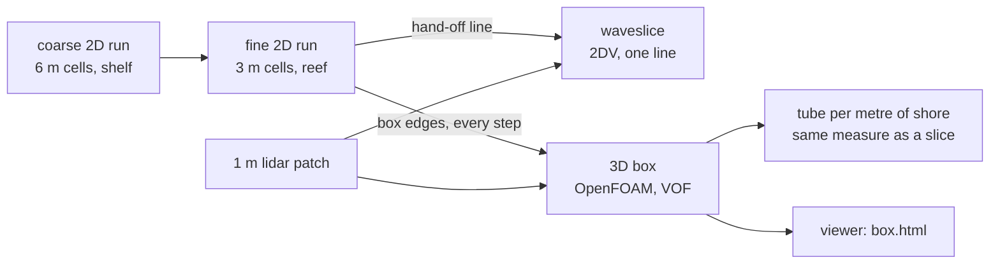

# A 3D box around the break (scope)

This is a plan, not a feature. It scopes handing the 2D run's swell to a three-dimensional
solver over a small box of reef, so that a wave can overturn and peel at the same time. Nothing
here is built yet. The numbers marked *estimate* still have to be measured.

## The question it answers

The slices break one line of reef at a time. On Pipeline, every line closes a tube about a metre
across or less, except the single 1 m lidar line at y = 511.5 m, which goes away once the bed is
averaged across 20 m. The plane beaches say why: a hollow tube needs ξ₀ near 1, and Pipeline's
lines give 0.17 to 0.55. The README leaves two explanations open:

1. the real reef is steeper where the wave stands up than the survey shows, or
2. the barrel comes from something a slice leaves out. The waves peel, with their crests about
   20° to the line of break points, and their height changes by up to 2 m over 60 m of shore.

A slice cannot test the second. A 3D box can, and on the same 1 m lidar it holds the first fixed.
That gives one question:

> **On the same bed and the same swell, is the tube in 3D bigger than the slices' tube?**

If it is, the peel is what makes Pipeline hollow, and the slices were never going to show it. If
it is not, explanation 2 is ruled out and the answer lies in the bed.

## Where the box sits

The box is a third level of nesting, set up like the coarse-to-fine one that already exists. The
fine run already feeds a relaxation zone from the coarse one. Here, the fine run would record
the sea along three edges of the box for the 3D solver to use as inflow.

## Why OpenFOAM, and not something written here

| Option | What it would take | Verdict |
|---|---|---|
| Write a 3D two-phase Navier–Stokes VOF solver in Rust | Years of work, and a solver that has to be validated from scratch | No |
| Extend `waveslice` to a 3D boundary element method (Grilli et al. 2001) | The 2D dense solve already takes 8 to 27 min per break and grows with the cube of the node count. In 3D the node count is roughly squared, so it would need a fast multipole method first | No: a research project in itself |
| **OpenFOAM** (`interFoam`, VOF, ESI release v2512) | Glue code only: export inflow, mesh the bed, measure the result | **Yes.** It is the field's open standard for breaking waves, and arm64 Docker images run natively on the M5 |
| Basilisk (octree VOF, Popinet) | Adaptive mesh, so cells only where the surface is, which is far cheaper for a lip. Real seabeds are less well supported, and the community is smaller | Plan B, if the fixed mesh is too slow |
| SPH (DualSPHysics) | Fast on a CUDA GPU, which this machine does not have | No |

This keeps to the project's rule of verification first. The new code is the coupling, and the
coupling is what gets tested. OpenFOAM's VOF has been validated against breaking waves by
others. What has to be shown here is that it agrees with `waveslice` where both apply.

**Physics the box adds that a slice lacks:** the second horizontal direction (peel, the crest
varying along its length, flow along the shore), air, viscosity, and life after the lip lands
(splash-up, the tube collapsing, foam). **Physics it gives up:** nothing that a slice up to
landing gets right. VOF smears the surface over one or two cells, though, so a tube needs about
eight cells across before it can be measured. That is the cost driver below.

## The first case: 3.5 m, 16 s on y = 511.5 m

From `out/pipeline_big_map` (the hand-off line at y = 511.5 m):

| Along `x` | Still-water depth |
|---|---|
| 1774.5 m | 12 m |
| 2095.5 m | 9 m (the slices' hand-off) |
| 2143.5 m | 6 m |
| 2185.5 m | 4 m (the slice's face goes vertical at 2185–2193 m) |
| 2305.5 m | 0.5 m |

At 16 s, the wavelength is 147 m in 9 m of water and 101 m in 4 m.

**Box, in the bed's frame:**

- **`x`:** 2040 to 2320 m (280 m). The inflow edge sits about half a wavelength outside the 9 m
  point, and the box runs to the beach.
- **`y`:** 431.5 to 591.5 m (160 m). This takes in the lines at 481.5, 511.5 and 541.5 m, with
  40 m of buffer to each side. With a 20° peel, a crest breaks along about 55 m of shore for each
  20 m it moves forward.
- **`z`:** −11 to +9 m above still water. That covers the 10.5 m deep inflow and a 5.5 m crest,
  plus room for the splash.

**Mesh** (*estimate*, using snappyHexMesh on an STL of the bed):

| Tier | Cells | Where they are fine | Tube it can measure | Runs on |
|---|---|---|---|---|
| A | about 4 M | 1 m background, 0.5 m from −3 to +7 m over the whole box | about 2 m or more | the laptop, overnight |
| B | about 13 M | as A, plus 0.25 m over the 100 m around the break (x 2140–2240) | about 1 m or more | a rented machine with many cores |

Tier A answers the yes-or-no question: the slices' tubes are 0.7 m across, and a 2 m tube would
be news. Tier B puts a size on the answer. It starts from tier A mapped onto the finer mesh
(`mapFields`), shortly before the wave being measured reaches the break, so it only needs about
20 s of the wave's time.

**Cost** (*estimate*). The time step is held to Courant 0.5 with velocities up to about 10 m/s in
the lip, so the step is 0.025 s on 0.5 m cells. Tier A runs 80 s of the wave's time: about 18 s
for the first crest to reach the break, then four waves. That is 3,200 steps. The cost per
cell-step for `interFoam` is assumed to be 3 to 10 µs on one core.

| Tier | Steps | Core-hours | Laptop (4 cores) | 48-core machine |
|---|---|---|---|---|
| A | 3,200 | 11 to 36 | 3 to 9 h | under 1 h |
| B | 1,600 | 17 to 58 | not sensible: needs about 25 GB inside the VM | 0.5 to 1.5 h |

These are guesses, good to a factor of about three. Milestone 0 replaces them with a measurement.

## What has to be built

### In wavesim (Rust)

1. **`wavesim run --box X0,X1,Y0,Y1`** records the fine grid along the box's offshore edge and its
   two sides at every solver step, from the start of the settled sea to the end of the run. It
   writes `box/boundary.json` and `box/boundary.f32` in a new format, `wavesim-boundary` version
   1, documented in [data-format.md](data-format.md). The fields per edge point are `eta`, `ubar`,
   `vbar`, the still depth and the bed slope. The run refuses a box that does not lie inside the
   fine grid's trusted width (outside `side_margin_cells`), or whose offshore edge lies seaward of
   the fine grid's relaxation zone. The data is small: about 600 edge points, five fields, and a
   few thousand steps come to tens of MB.
2. **The velocity profile in depth, in 2D.** `handoff.rs` already uses the SGN profile at the
   surface (`u = ubar − H²/3 ubar_xx`). The box needs it at every height `ζ` above the bed:
   `u(ζ) = ū + (H²/6 − ζ²/2) ∇(∇·ū)` and `w(ζ) = −ζ ∇·ū − ū·∇h`. This belongs in `wavecore` as a
   pure function and is tested against the surface rule (`ζ = H`) and against linear theory.
3. **`wavesim measure`** takes a cross-section's surface (from the box) and returns face-vertical,
   curl, landing and tube, using the same code as `waveslice::Tank::tube`. Keeping one definition
   in one place means the 3D tube and the slice tube are measured the same way.

### In tools (Python, uv)

4. **`tools/fetch_patch.py`** crops the 2013 USACE 1 m lidar over the box in the bed's frame. It
   reuses `fetch_spot.py` with the box's limits and 1 m cells, and writes a bed file plus an STL
   for snappyHexMesh. Outside the lidar's coverage it falls back to the 3 m bed and records where
   it did so.
5. **`tools/foam_case.py`** writes an OpenFOAM case from the patch and the boundary record:
   - `blockMeshDict` and `snappyHexMeshDict` for the box, with the refinement band and zone of
     the chosen tier.
   - Still water through `setFields`.
   - `boundaryData/` for `timeVaryingMappedFixedValue` on `U` and `alpha.water` at the inflow and
     side patches: `alpha` is 1 below `eta`, and `U` comes from item 2.
   - `fixedFluxPressure` on those patches, and an atmosphere on top (`totalPressure`,
     `pressureInletOutletVelocity`, `inletOutlet` on `alpha`).
   - `maxCo` and `maxAlphaCo` of 0.5. The model is laminar, because the comparison stops at
     landing, and RANS models over-produce turbulence under waves that have not broken (Larsen &
     Fuhrman 2018).
   - Function objects that write the `alpha = 0.5` iso-surface every 0.1 s during the break, plus
     cross-sections every 2 m along `y`.
6. **`tools/foam_tubes.py`** reads each cross-section's `alpha = 0.5` contour, keeps the free
   surface and any air it encloses, and passes it to `wavesim measure`. The output is the tube
   per metre of shore, plus two measures only 3D has: **the peel speed**, how fast the landing
   point moves along the shore, and **the tube's length**, how far along the shore it stays
   closed at once.

### In the viewer

7. **`viewer/box.html`** plays the iso-surface frames over the terrain, using the same camera and
   colouring as the side view. This needs a compact mesh format, `wavesim-surface` version 1,
   with indexed triangles per frame and decimated: at 0.5 m an undecimated frame is about 200k
   triangles. This is last in the list. The numbers come first.

## Validation, in order: each step must pass before the next

| Step | Case | Compare with | Passes when |
|---|---|---|---|
| **V0** | OpenFOAM `damBreak` tutorial, then a 1 M-cell box | — | it runs in Docker (`opencfd/openfoam-default:2512`, arm64), and the cost per cell-step is measured. That sets the cost table above |
| **V1** | 2D (one cell thick): solitary wave on the `steep` seabed | `waveslice`: face vertical 15.97 s at 222.3 m, crest 3.27 m, lip 10.72 m, tube 1.61 × 3.14 m | the face goes vertical within 2 m, and the crest is within 5%. The tube is within 20% at some cell size, run at 0.4, 0.2 and 0.1 m. **That cell size becomes the 3D box's cell size.** |
| **V2** | 2D: plane beach 1 in 10, 2 m and 12 s, inflow from a `wavesim run --box` on that beach | the slice table: tube 1.8 × 2.8 m | the same tolerances. This tests the export and the velocity profile |
| **V3** | 3D box over the same plane beach, uniform along the shore | V2 | the tube is the same on every cross-section, and the same as V2 within 10%. This tests the sides and the 3D mesh |
| **V4** | 3D, the same beach with the swell 20° oblique | the 2D run's own peel angle | the peel measured from landing points matches the angle the 2D run gives where waves break, within a few degrees |
| **P1** | Pipeline box, tier A | the slices at 481.5, 511.5 (50 m strip) and 541.5: tubes 0.6 to 0.7 m | — this is the answer |
| **P2** | Pipeline box, tier B | P1 | a tube the same size within 20% between tiers, or else the result is not converged and the report says so |

V1 to V3 are cheap: 2D cases take minutes, and V3 can use a short box. They fit on the laptop
under the usual guard, a time limit plus thermal readings. One difference from wavesim's runs:
inside OrbStack's VM, a run cannot be pinned to the efficiency cores. The VM should be limited
to 4 CPUs, and the thermal readings taken as before.

### V1 result, 2026-11-04: the face passes, the tube does not

`cases/v1-steep/`: `make_case.py` builds the case, `run.sh <dx> <limit>` runs it on one core under
the guard, and `measure.py` measures it as `wavesim slice` does. Thermal state stayed nominal
throughout all three runs. `interFoam` cost 1.7 µs per cell-step on one core in 2D.

| | waveslice | 0.4 m | 0.2 m | 0.1 m |
|---|---|---|---|---|
| Cells, wall time | — | 22,575, 2 min | 90,300, 14 min | 361,200, 1 h 46 min |
| Face vertical | 15.97 s, 222.26 m | 15.75 s, 220.56 m | 15.78 s, 220.55 m | 15.75 s, 220.42 m |
| Crest then | 3.27 m | 3.03 m (−7%) | 3.13 m (−4%) | 3.14 m (−4%) |
| Lip lands | 16.93 s | 16.80 s | 16.80 s | 16.62 s |
| Lip thrown | 10.72 m | 11.13 m | 10.90 m | 8.93 m (−17%) |
| Tube, height × width | 1.61 × 3.14 m | 0.98 × 3.25 m | 1.49 × 2.80 m | 1.75 × 1.85 m |
| Tube area | 3.16 m² | 0.97 m² (−69%) | 1.60 m² (−49%) | 1.37 m² (−57%) |

The face and the crest pass at 0.2 and 0.1 m, and the face has converged: 220.4–220.6 m at all
three sizes, 1.8 m short of waveslice's. The tube fails at every size, and it has not converged
either: the width and the throw still change from 0.2 to 0.1 m.

Frame by frame, the two methods agree up to 15.6 s, and the 0.2 and 0.1 m surfaces lie on
waveslice's. From 15.9 s they part. waveslice's crest keeps rising to 3.3 m and throws the lip
from the top, with the face vertical below it. OpenFOAM's crest stops at about 3.15 m, and its
jet leaves the face lower down, at about 2.2–2.5 m. The two lips reach about as far shoreward
at the same moment, but OpenFOAM's falls more steeply and lands 2–4 m sooner, over a tube of
about the same height and half the area.

Which one is right is open. Potential-flow BEM is known to follow lab overturning closely up to
touchdown. Algebraic VOF (MULES) smears a lip that is only 3–5 cells thick at 0.1 m. Two 2D
checks could tell them apart, each one core for a few hours:

- **Sharper interface:** the 0.1 m case with `interIsoFoam` (geometric isoAdvector) in place of
  `interFoam`. If the lip moves towards waveslice, the smearing was the cause.
- **Finer cells only at the break:** 0.05 m over x 210–240, z −1 to +4, and 0.1 m elsewhere.
  If the tube still changes from 0.1 to 0.05 m, no fixed mesh that fits in 3D will measure it,
  and Basilisk's adaptive octree becomes the route, not plan B.

Until one of them passes, tier A's 0.5 m cells and tier B's 0.25 m cells are known to be too
coarse for the tube. At 0.4 m the area came out at a third of waveslice's.

## Risks and open choices

- **Reflection at the inflow.** `timeVaryingMappedFixedValue` imposes the 2D run's sea and does not
  absorb what comes back from the beach. The surf zone absorbs most of it, but the reflected
  fraction should be measured in V2. If it matters, the fix is a relaxation zone inside the box
  (waves2Foam-style), at the cost of some extra length along `x`.
- **The sides.** Feeding the sides from the 2D run is consistent seaward of the break. Shoreward,
  the 2D run's bores will differ from the 3D overturning. The plan keeps 40 m between each side
  and the lines measured. An alternative is slip walls on the sides, which mirror the bed as the
  2D run's walls do. V3 and V4 should decide.
- **The bed outside the lidar.** If the lidar has gaps inside the box, the patch mixes 1 m and 3 m
  data. `fetch_patch.py` records where, and the measurements report it per cross-section.
- **The resolution needed for the tube.** It is unknown until V1. If V1 says 0.1 m, tier B
  becomes about 100 M cells, and the move to Basilisk's adaptive octree is worth making there.
- **Time to first answer.** V0 to P1 is roughly three weeks of evenings, most of it in items 1, 5
  and 6 (*estimate*). The viewer can wait.

## What it will not do

- It will not replace the 2D run. The box is a few hundred metres across and costs hours. The
  2D run covers the reef and the whole shelf in minutes.
- It will not make the swell input or the bed more certain. A 3D answer on a 3 m bed, or for a
  swell no buoy saw, is still only as good as those inputs.
- It will not model foam or air bubbles beyond what VOF resolves. Air entrained after landing is
  outside what the comparison uses.

## References

- Grilli, S. T., Guyenne, P. & Dias, F. (2001). A fully non-linear model for three-dimensional
  overturning waves over an arbitrary bottom. *Int. J. Numer. Meth. Fluids* 35.
- Larsen, B. E. & Fuhrman, D. R. (2018). On the over-production of turbulence beneath surface waves
  in Reynolds-averaged Navier–Stokes models. *J. Fluid Mech.* 853.
- Mostert, W., Popinet, S. & Deike, L. (2022). High-resolution direct simulation of deep water
  breaking waves: transition to turbulence, bubbles and droplets production. *J. Fluid Mech.* 942.
- Fincham, A. & Pieszka, M. CFD of the Surf Ranch wave, *Proc. ICCE*:
  https://icce-ojs-tamu.tdl.org/icce/article/view/12736
- OpenFOAM (ESI) Docker images: https://hub.docker.com/r/opencfd/openfoam-default/tags
