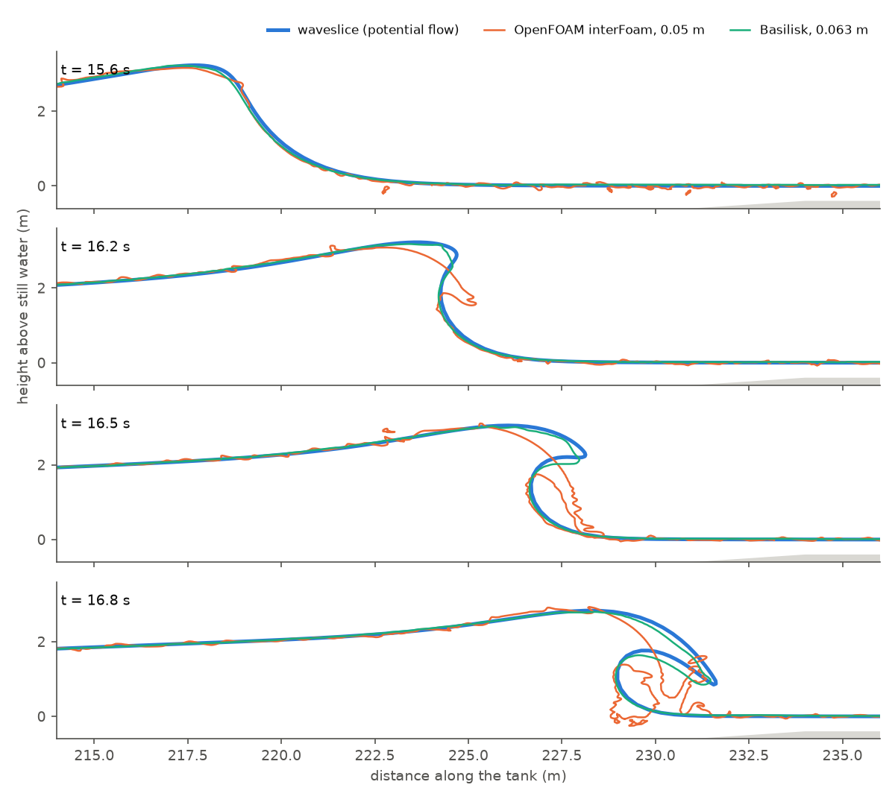
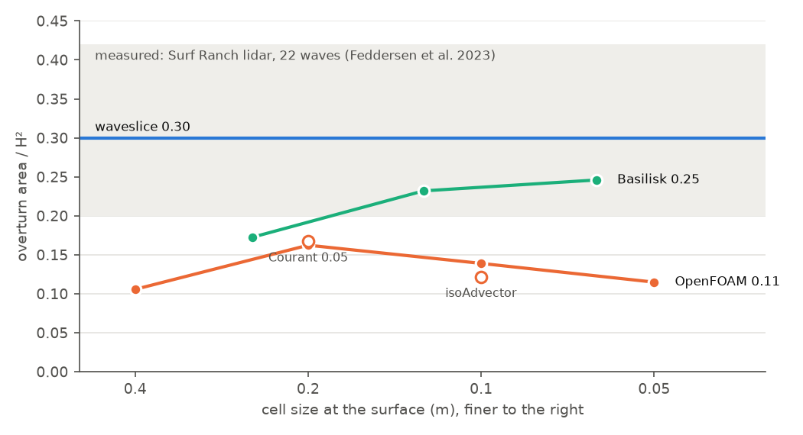
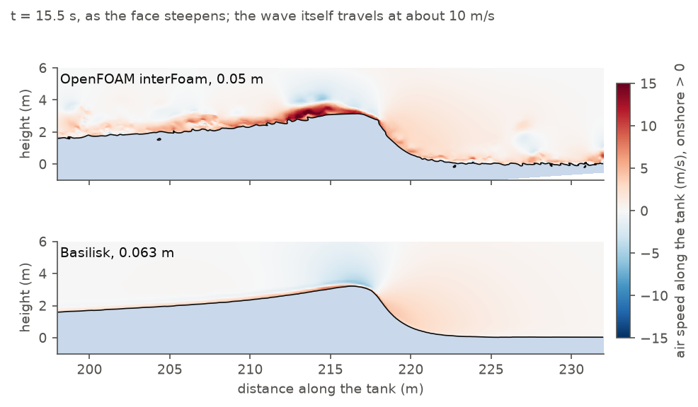

# One breaking wave, three models, and the measurements that decide between them

November 2026. A check of wavesim's breaking-wave model against two standard
air-and-water solvers and against lidar measurements of real waves. The standard engineering
solver, run with its usual settings, makes the tube less than half the size the measurements
support, and does so consistently. The measurements show which models are right, and a series of
controlled runs narrows down why the standard solver is wrong.

**In short**

- **The test:** the same 2.4 m wave breaks on the same slope in three models:
  - `waveslice`, wavesim's own potential-flow solver;
  - OpenFOAM's `interFoam`, the standard open-source engineering solver;
  - Basilisk, the research solver used for the Surf Ranch studies.

  They are scored by the measure the field data uses: the area of the tube when the lip lands,
  divided by the wave height squared (A/H²).
- **The result:** waveslice gives 0.30 and Basilisk 0.25. Both lie inside the 0.20–0.42 that
  lidar measured on 22 real waves at the Surf Ranch. OpenFOAM gives 0.11 to 0.17 at every
  setting tried, below everything measured.
- **Not the usual suspects:** six OpenFOAM runs all stay below the measured range, across an
  8-fold range of cell size, two ways of tracking the surface and a 10-fold smaller time step.
  The error is in the method, not the resolution.
- **The likely cause:** OpenFOAM's air just above the wave rushes onshore, in places faster
  than the wave itself. Basilisk's barely moves. An onshore wind that strong is known
  from the measurements to shrink the tube. That OpenFOAM's air causes its small tube is
  likely, but not proven here.

## Why it was needed

wavesim forecasts how waves break at real surf spots. A depth-averaged model carries the swell
from offshore across the real seabed. Near the break, `waveslice` takes over and follows one
wave side-on until its lip lands, which gives the shape and size of the tube. waveslice is
potential flow: it ignores the air and any viscosity, and it can follow the lip only until the
lip touches the water.

The natural next step was a 3D model of the break, to see how the peel along the reef shapes
the tube. That needs a full air-and-water solver, so the solver had to be checked first, on a
case small enough to run on a laptop.

## The test case

A 2D tank, 258 m long:
- water 8 m deep, flat for 120 m, then a 1-in-15 slope up to a shelf 0.4 m deep;
- one solitary wave, 2.4 m high, sent towards the slope;
- the same fluids, walls and starting wave in all three models: water and air at their real
  densities and viscosities, surface tension, no wind.

Each run is measured the same way, by `cases/v1-steep/measure.py`:
- when and where the front face goes vertical;
- the crest height at that moment;
- when and where the lip lands;
- the size of the air pocket it closes off.

Every run went on one laptop core, under a guard that stops it at the first sign of heat.

## What the three models do



Up to 15.6 s the three surfaces lie on one another. After that:
- waveslice's crest keeps rising and throws the lip from the top;
- Basilisk follows it closely, overturn included, with a slightly thinner lip that lands a
  little sooner;
- OpenFOAM's crest stops about 10 cm lower, its jet leaves the face lower down, and it falls
  steeply into a narrow pocket.

| | waveslice | Basilisk, 0.063 m cells | OpenFOAM, 0.05 m cells |
|---|---|---|---|
| Face vertical | 15.97 s, 222.3 m | 16.10 s, 223.5 m | 15.75 s, 220.5 m |
| Crest then | 3.27 m | 3.22 m | 3.15 m |
| Lip lands | 16.93 s | 16.95 s | 16.52 s |
| Lip thrown | 10.7 m | 9.4 m | 7.7 m |
| Tube, height × width | 1.61 × 3.14 m | 1.49 × 2.83 m | 1.54 × 1.41 m |
| Tube area | 3.16 m² | 2.55 m² | 1.14 m² |
| **A/H²** | **0.30** | **0.25** | **0.11** |

OpenFOAM's tube is as tall as the others, but half as wide.

## Which one is right



Feddersen and colleagues measured this exact quantity on real waves: lidar on 22 waves at the
Surf Ranch, a wave pool in California (Feddersen et al. 2023). They found A/H² between 0.20 and
0.42, smaller with onshore wind and larger with offshore wind. Two other models of the same
wave without wind fall inside that range: their Basilisk model gives 0.35 (Feddersen et al.
2024), and potential flow gives 0.38 (Pick & Feddersen 2026).

waveslice (0.30) and Basilisk (0.25) fall inside the measured range, and OpenFOAM falls
below it. The chart also shows the convergence:
- **Basilisk:** finer cells move it towards waveslice. From 0.126 to 0.063 m the tube grew by
  5%, after 28% the step before, so finer cells would add little.
- **OpenFOAM:** below 0.2 m, finer cells move it away. From 0.1 to 0.05 m it changed by 17%, and its three
  finest runs lie on one another frame by frame. It has converged, on the wrong answer.

At 0.063 m Basilisk passes the test that was set before the runs: the face goes vertical within
2 m of waveslice's, the crest is within 5% and the tube within 20%. OpenFOAM fails the tube at
every cell size.

## Ruling out the usual causes

Each candidate was tested by changing one thing and re-running:

| Suspect | What was changed | Tube area (A/H²) | Verdict |
|---|---|---|---|
| Cells too coarse | 0.4 → 0.2 → 0.1 → 0.05 m | 0.97 → 1.60 → 1.37 → 1.14 m² (0.11 → 0.16 → 0.14 → 0.11) | converged, below range |
| Surface smeared over two cells | `interFoam` (MULES) → `interIsoFoam` (isoAdvector), at 0.1 m | 1.37 → 1.20 m² (0.14 → 0.12) | same direction, smaller step |
| Time step too large (Larsen et al. 2019) | Courant number 0.5 → 0.05, at 0.2 m (2 h instead of 14 min) | 1.60 → 1.68 m² (0.16 → 0.17) | no real change |
| The method itself | Basilisk, the same case | 2.55 m² (0.25) | inside the measured range |

The time-step test mattered most. Larsen, Fuhrman & Roenby (2019) showed that `interFoam` at
its usual Courant number of 0.5 makes the crest too fast and the air above it too fast. They
recommend 0.05. Our OpenFOAM runs showed both symptoms, yet the tube did not change at 0.05.

## The likely cause: wind that isn't there



At 15.5 s, half a second before the face goes vertical:
- **OpenFOAM:** a thin layer of air along the back of the wave and over the crest moves
  onshore at 10–15 m/s, and peaks at over 20 m/s. The wave moves at about 10 m/s, so this air
  keeps pace with it or outruns it.
- **Basilisk:** the air in the metre above the crest moves at −0.5 to +1.2 m/s on average from
  14.5 to 16 s.

| Air in the metre above the crest, 14.5–16 s | Mean onshore speed | 5% of it faster than | Fastest |
|---|---|---|---|
| OpenFOAM, 0.2 m cells | 8–11 m/s | 15–17 m/s | 18–20 m/s |
| OpenFOAM, 0.05 m cells | 3–5 m/s | 11–14 m/s | 15–23 m/s |
| Basilisk, 0.063 m cells | −0.5 to +1.2 m/s | 4–9 m/s | 5–15 m/s |

Finer cells make OpenFOAM's fast layer thinner but not slower. It is there from as early as
10 s, and a 10 times smaller time step barely changed it: at 0.2 m its mean fell by 1–2 m/s. It
acts like a strong onshore wind, and an onshore wind is exactly what the measurements show
flattens the overturn.

Why only OpenFOAM? Across the surface the density jumps by a factor of 1000. Basilisk was run
with a scheme that carries momentum together with the water fraction
(`navier-stokes/conserving.h`), built for such jumps. `interFoam` moves the water fraction and
the momentum with separate schemes that do not quite match at the surface, so a little of the
water's momentum can end up in the light air. That fits what the runs show. But what was
tested here shows that the fast air and the small tube go together, not that one causes the
other.

## What it cost

| | Cells (most at once) | Wall time, one core |
|---|---|---|
| waveslice | 429 nodes along the surface | 8–27 min |
| OpenFOAM, 0.05 m (last 4 s only) | 492,800 | 1 h 51 min |
| Basilisk, 0.063 m (whole run) | 76,261 | 18 min |

Basilisk costs more per cell (4.5 µs per cell-step against 1.7), but its adaptive mesh puts fine
cells only along the surface and the bed. It needed a seventh of OpenFOAM's cells at a finer
size, so it finished the whole run six times faster than OpenFOAM finished its last four
seconds.

## What this does not show

- **One wave, in 2D, without wind.** It's a solitary wave on a plane slope. A swell on a real
  reef, and the 3D peel, are not tested here.
- **waveslice and Basilisk still differ.** Basilisk's tube is 19% smaller, mostly in the last
  metre of the lip. A lip in Basilisk is a few cells thick and can thin out and fall. A lip in
  potential flow has no thickness limit. Some of the gap is expected, but how much is not
  pinned down.
- **OpenFOAM with its usual settings, not with every option.** Other ways of coupling the air
  and the water, or tuned settings, might do better. The tutorial settings used here are
  a common starting point, so the result is a warning about those.
- **The cause is likely, not proven.** Proving it would take, for example, a run with the air
  made heavier or held still.

## Where it led

Basilisk replaced OpenFOAM as the solver for the 3D model, at 0.063 m cells on the surface.
A first 3D test, a 4 m wide strip of this same tank, breaks as the 2D run does: the face goes
vertical and the lip lands at the same moments, to 0.01 s. It
measured what a full 3D break would cost: about 400 core-hours for a coarse first answer.
waveslice's tubes in wavesim's forecasts now have independent support from a full
air-and-water model and from field data.

Details, every run and the 3D plan: [docs/3d-box.md](3d-box.md).

## Reproducing it

```bash
cargo run --release -p wavesim -- slice steep                 # waveslice
cases/v1-steep/run.sh 0.1 5400                                # OpenFOAM at 0.1 m (Docker)
cases/v1-steep/run.sh 0.05 10800 --x0 170 --from 0.1@14.5     # OpenFOAM at 0.05 m
cases/v1-basilisk/run.sh 12 3600                              # Basilisk at 0.063 m (Docker)
cd cases/v1-steep && uv run -q --python 3.12 --with numpy --with matplotlib --with contourpy \
    python ../v1-basilisk/figures.py ../../img/v1             # the figures on this page
```

Basilisk is built from its source tarball first (see `cases/v1-basilisk/v1.c`). `measure.py`
gives the numbers in the tables: `cases/v1-steep/measure.py out/<run>`.

## References

- Feddersen, F., Fincham, A. M., Brodie, K. L., Young, A. P., Spydell, M. S., Grimes, D. J.,
  Pieszka, M. & Hanson, K. (2023). Cross-shore wind-induced changes to field-scale overturning
  wave shape. *J. Fluid Mech.* 958, A4.
- Feddersen, F., Hanson, K., Mostert, W. & Fincham, A. (2024). Modelling wind-induced changes to
  overturning wave shape. *J. Fluid Mech.* 1000, A48.
- Pick & Feddersen (2026). Scaling the shape of shoaling and overturning solitary waves.
  *J. Fluid Mech.* 1040, A8.
- Larsen, B. E., Fuhrman, D. R. & Roenby, J. (2019). Performance of interFoam on the simulation
  of progressive waves. *Coastal Engineering Journal* 61(3), 380–400.
